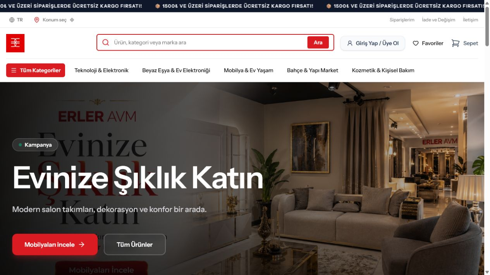
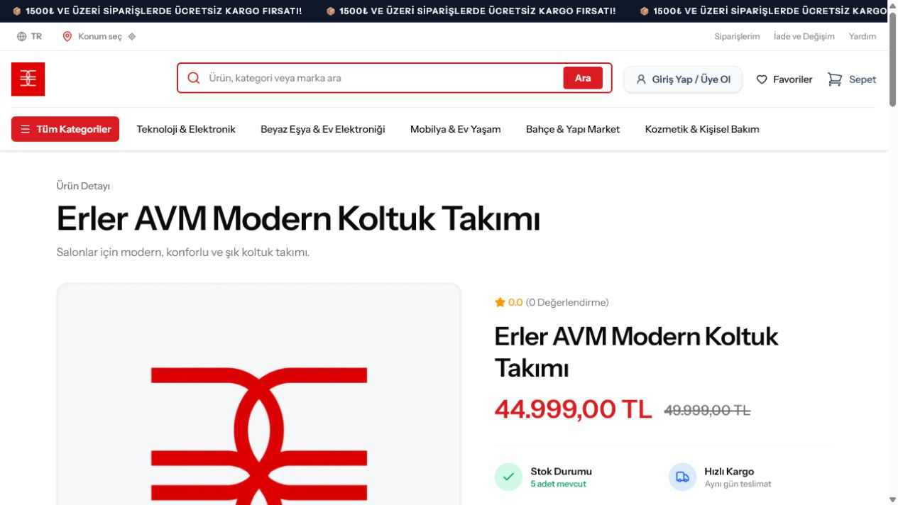
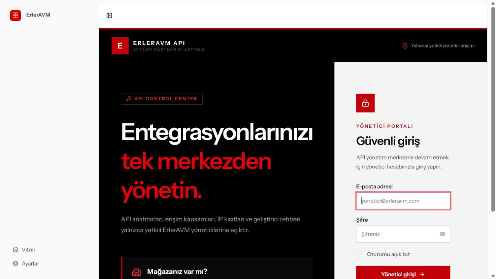

# ErlerAVM

ErlerAVM; Laravel, Inertia.js ve Vue ile geliştirilen kapsamlı bir e-ticaret platformudur. Proje; modern mağaza vitrini, ürün ve stok yönetimi, sipariş süreçleri, ödeme entegrasyonları, müşteri hesapları, yönetim paneli, mobil uygulama ve güvenli API altyapısını tek sistemde birleştirir.

## Ekran Görüntüleri

### Mağaza Vitrini



### Ürün Detayı



### API Yönetim Portalı



## Öne Çıkan Özellikler

- Kategori, marka, ürün, varyant ve gerçek zamanlı stok yönetimi
- Sepet, favoriler, sipariş, iade ve müşteri hesabı akışları
- Akbank 3D Secure ve PayTR ödeme altyapıları
- Rol, izin ve yönetici PIN doğrulamalı yönetim paneli
- API anahtarı, kapsam ve IP kısıtlaması destekli REST API
- Kampanya, kupon, içerik, SEO ve bildirim yönetimi
- SwiftUI tabanlı iOS istemcisi
- Pest ile feature ve entegrasyon testleri

## Teknolojiler

- PHP 8.4, Laravel 13, Laravel Fortify, Sanctum ve Octane
- Inertia.js 3, Vue 3, TypeScript ve Tailwind CSS 4
- Microsoft SQL Server
- Pest 4
- SwiftUI

## Yerel Kurulum

```bash
composer install
npm install
cp .env.example .env
php artisan key:generate
php artisan migrate --seed
npm run build
```

Uygulamayı çalıştırmadan önce `.env` dosyasında veritabanı ve kullanılacak ödeme servislerinin test bilgilerini yapılandırın.

## Güvenlik

Gerçek kimlik bilgileri ve üretim anahtarları depoya dahil edilmez. Ödeme entegrasyonları varsayılan olarak test veya devre dışı yapılandırmayla sunulur.

